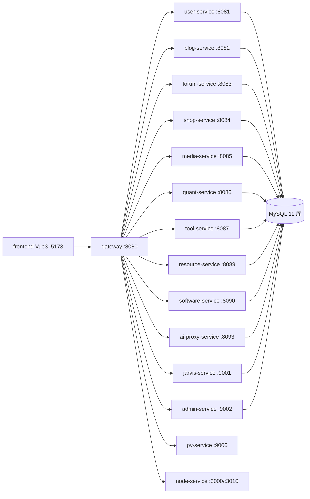

# 模块说明（MODULES）

> 最后更新：2026-10-20
> 覆盖：13 个 Java 微服务 + 1 个网关 + py-service（12 模块）+ node-service（2 服务）
> 端口/库名以各服务 `src/main/resources/application.yml` 与 `backend/deploy/mysql/init/*.sql` 为准。

---

## 一、总体拓扑

网关不做鉴权（`anyExchange().permitAll()`，见 `GatewaySecurityConfig`），**鉴权由各服务内的 `AuthUtils.requireUserId / requireAdmin` 自行完成**。新增接口必须自带鉴权调用，否则即为公开接口。

---

## 二、Java 服务清单

| 服务 | 端口 | 数据库 | 职责 | 网关路由前缀 |
|---|---|---|---|---|
| gateway | 8080 | - | 统一入口、JWT 解析注入、第三方 API 代理 | - |
| user-service | 8081 | web3_user | 注册/登录/OAuth/邮箱短信 OTP/资料/权限/公会 | `/user/**` `/guild/**` |
| blog-service | 8082 | web3_blog | 文章/分类/标签/导航/公告/Feed | `/article/**` `/blog/**` |
| forum-service | 8083 | web3_forum | 帖子/评论/点赞/聊天室 | `/post/**` `/comment/**` `/chat/**` |
| shop-service | 8084 | web3_shop | 商品/订单/购物车/支付宝·微信支付 | `/product/**` `/order/**` `/pay/**` |
| media-service | 8085 | web3_media | 音乐/视频/书籍/播放列表/相册/美甲 | `/music/**` `/video/**` `/book/**` `/playlist/**` `/photo/**` `/nail/**` |
| quant-service | 8086 | web3_quant | 量化策略 CRUD 与回测触发/行情 | `/strategy/**` `/quant/**` `/stock/**` |
| tool-service | 8087 | web3_tool | 在线脚本工具、站点分享 | `/script/**` `/site/**` |
| resource-service | 8089 | web3_resource | 资源上传/下载 | `/resource/**` |
| software-service | 8090 | web3_software | 软件列表与下载 | `/software/**` |
| ai-proxy-service | 8093 | web3_admin（共库） | OpenAI 兼容代理、渠道令牌计费、Agent 编排 | `/v1/**` `/admin/ai/**` `/user/ai/**` `/agent/**` |
| jarvis-service | 9001 | web3_jarvis | 语音助手意图识别 | `/jarvis/**` |
| admin-service | 9002 | web3_admin | 仪表盘/用户管理/日志/流量/服务健康 | `/admin/**` |

> `software-service` 端口可被 `SOFTWARE_SERVICE_PORT` 覆盖（默认 8090），网关侧同样读取该变量。

### common 模块

| 子模块 | 职责 |
|---|---|
| `common-core` | `ApiResponse` / `PageResult` / `BaseService` 等基础返回体 |
| `common-security` | `JwtUtil` / `JwtProperties` / `AuthUtils` / 鉴权过滤器 |
| `common-util` | `JsonUtils` 等工具 |

`JwtProperties` 为 fail-fast：`JWT_SECRET` 缺失或短于 32 字符时服务直接启动失败，无兜底默认值。

---

## 三、py-service（:9006，单进程多模块）

入口 `py-service/main.py`，模块由 `core/loader.py` 按约定自动发现并挂载，新增模块无需改 `main.py`。

| 模块 | 名称 | 说明 |
|---|---|---|
| `ai` | AI 通用通道 | 多免费模型轮询（Pollinations / Gemini / Mistral / Groq / OpenRouter 等），`/api/ai/chat` + SSE 流式 |
| `quant` | 量化交易 | A 股行情、龙虎榜、资金流、研报、回测、大屏 |
| `cockpit` | 市场驾驶舱 | 独立静态前端壳（echarts + router），gzip 压缩 |
| `qzone` | QQ 空间备份 | 说说/相册导出 |
| `video` | 视频服务 | yt-dlp 下载、OSS 上传 |
| `voice` | 语音助手 | TTS/ASR 编排 |
| `whisper` | 语音识别 | 本地 Whisper 转写 |
| `wifi` | WiFi 安全审计 | 周边网络扫描、网卡审计、wifiphisher/wifite 引擎封装（**仅 Linux 生效**，vendor 目录内置第三方源码） |
| `osint` | OSINT 信息收集 | Shodan 等外部情报源 |
| `ghosttrack` | GhostTrack 网络追踪 | IP/手机号/用户名关联查询 |
| `scrape` | 网页采集 | 选择器抓取 + 转 Markdown |
| `monitor` | 系统监控 | CPU/内存/磁盘/进程指标 |

鉴权：`core/auth.py` 统一校验 JWT；`wifi` / `osint` 需登录且具备对应权限（管理员放行），WebSocket 走 `?token=<JWT>`，运维脚本可用 `X-Admin-Token`。

---

## 四、node-service

| 服务 | 端口 | 说明 |
|---|---|---|
| `netease-music-api` | 3000 | 网易云音乐接口，网关 `/netease/**` 转发 |
| `chat-gateway` | 3010 | 聊天网关（WebSocket 转发） |

---

## 五、新增模块步骤

### 新增 Java 微服务

1. 在 `backend/` 下新建模块，父 POM 继承 `backend/pom.xml`，`<artifactId>` 加入 `<modules>`
2. 分层：`controller → service → mapper → entity / dto / vo`
3. `application.yml` 中端口用 `${XXX_PORT:默认}`，数据源用 `${MYSQL_HOST:127.0.0.1}`
4. 在 `gateway/src/main/resources/application.yml` 新增路由，host 用 `${XXX_SERVICE_HOST:localhost}`
5. 在 `backend/deploy/mysql/init/` 新增编号 SQL（**必须带 `USE <库>;`**，INSERT 用 `INSERT IGNORE` 保持幂等）
6. 前端：新增 `api/xxx.js`、`views/xxx/`、路由与 `utils/permissions.js` 权限项
7. 同步更新本文件、`README.md` 端口表、`.env.example` 环境变量

### 新增 py-service 模块

1. 新建 `py-service/modules/<name>/`，提供 `__init__.py`（导出 `title` / `router` / 可选 `setup` `startup` `shutdown` `health`）
2. 路由前缀统一 `/api/<name>/`
3. 在 `gateway` 加 `/api/<name>/**` 路由（指向 `PY_SERVICE_HOST:9006`）
4. 依赖写入 `py-service/requirements.txt`

---

## 六、约定与约束

- **ID 序列化**：雪花 ID（19 位）超过 JS `Number.MAX_SAFE_INTEGER`，VO 的 `id` 字段必须加
  `@JsonSerialize(using = ToStringSerializer.class)`，前端不得对 id 做 `Number()` 转换。
- **上传安全**：`media-service` 的 `FileSecurityChecker` 是标准实现（扩展名白名单 + 魔数校验 + 路径穿越防护 + 大小上限 + 危险内容扫描），其他服务新增上传应复用同一策略。
- **事务**：涉及多表写（扣库存、核销、计数联动）的方法必须加 `@Transactional`。
- **分页**：新服务必须配置 `MyBatisPlusConfig` 的 `PaginationInnerInterceptor`，否则 `PageResult.total` 恒为 0。
